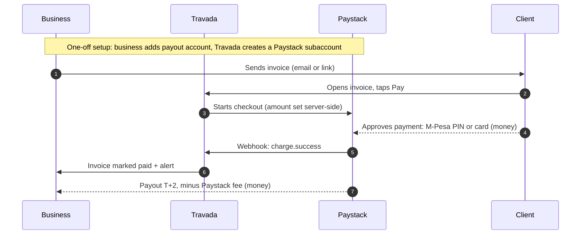

# Invoice Payments Plan — clients pay invoices online (Paystack first)

_Date: 2026-10-13, updated 2026-10-17 with Paystack's answers. Status: plan only, nothing built. Model decided: subaccounts (B), M-Pesa first, with our own risk checks (§5)._

_Implements `CONNECTED-ACCOUNTS-PLAN.md` §7 (multi-provider invoice payments) and narrows its first build to Paystack for Kenya. Bank sync lives in `BANK-SYNC-PLAN.md`; UAE payments via Lean are covered in §10 here only as a later provider._

Goal: a business sends a Travada invoice, the client opens `/i/:token`, taps **Pay**, pays by M-Pesa or card, and the invoice moves to paid / partially paid on its own. The money goes straight to the business; Travada never holds it.

## 1. Why Paystack first

Checked against paystack.com/docs on 2026-10-13.

- **Kenyan payment methods:** M-Pesa STK push, M-Pesa offline (Paystack Paybill + reference), payment from another business's M-Pesa Till, Airtel Money, cards (Visa, Mastercard, Amex), and Pesalink bank transfer (Kenyan-registered businesses, enabled on request).
- **Fees (Kenya):** 1.5% M-Pesa, 2.9% local cards, 3.8% international cards. No setup or monthly fees; volume discounts via kenya@paystack.com.
- **Settlement:** T+2 to a bank account or M-PESA wallet; USD settlement possible to a Kenyan USD account.
- **Licensed locally:** Paystack holds a CBK payment service provider licence and is Stripe-owned. Stripe itself does not onboard Kenyan businesses directly; Kenya is served through Paystack.
- **Free to integrate,** with an instant test mode, and no licensing blocker for Travada (a Kenyan-registered company).
- **Countries:** Kenya, Nigeria, Ghana, South Africa (and Côte d'Ivoire for some products). **Not the UAE**, so UAE businesses need a different provider (§10).

This changes the build order in `CONNECTED-ACCOUNTS-PLAN.md` §7 (which had Direct Daraja → IntaSend → Stripe → Paystack). Paystack now goes first: one integration covers M-Pesa *and* cards, there's no per-org Daraja onboarding, and Stripe is not an option from Kenya.

## 2. The model decision (decided 2026-10-17: B, subaccounts)

Paystack supports two ways to pay a business. §7 of the connected-accounts plan assumed the first.

| | **A. Business connects its own Paystack account** (§7 model, Midday-style) | **B. Subaccounts under Travada's Paystack account** (split payments) |
|---|---|---|
| Business onboarding | Signs up at Paystack, passes Paystack's KYC (registered business), pastes its secret key into Travada, and adds our webhook URL in its Paystack dashboard | Enters a bank account or mobile money (M-Pesa) account in Travada settings. Done in a minute |
| Who Paystack's customer is | The business | Travada; the business is a subaccount |
| Refunds, chargebacks, fraud | The business's account | Taken from the subaccount's payout if it hasn't been paid out yet; **Travada's main account once it has** (confirmed by Paystack) |
| Travada can take a cut | No | Yes: `percentage_charge` per subaccount or `transaction_charge` flat fee per payment; `bearer` decides who pays Paystack's fee |
| Secrets we store | Each org's Paystack secret key (encrypted) | Only our own key |
| Webhooks | One URL, but each org's account signs with *its own* secret key, so we look up the org before verifying | One URL, one secret |
| Freelancers without a registered business | Blocked by Paystack's KYC | Allowed. Paystack runs **no KYC** on subaccounts (confirmed) |

**Decision: B (subaccounts).** Onboarding friction is the main reason businesses don't turn on online payments, and B removes it completely.

**Paystack's answers (email to Curtis, 2026-10-17):**
1. Subaccounts can be paid out to mobile money accounts or bank accounts.
2. Refunds, chargebacks and fraud losses are carried by the main account (Travada), not the subaccount. If the transaction hasn't been paid out to the subaccount yet, Paystack deducts it from that payout instead and Travada carries nothing.
3. No KYC is required. Subaccounts can be individuals without a registered business.

They pointed to the [Transaction splits](https://support.paystack.com/en/articles/2132802) article, which adds:
- With one subaccount and a 0% main-account share, the subaccount pays Paystack's fee. `bearer: "subaccount"` makes it explicit.
- A deactivated subaccount's pending payout is held until it's re-enabled. Deactivating is therefore a way to freeze money before it leaves (§5).
- Paystack isn't liable for payouts to a wrongly entered account, so we must confirm the account name at connect time.

**What this means.** Answers 2 and 3 together put the fraud risk on Travada: anyone can sign up, invoice themselves, pay with stolen cards, get paid out to M-Pesa, and leave Travada with the chargebacks. Travada takes no cut, so it carries that risk without earning anything from payments. B is still the right model, but only with our own checks (§5): **v1 is M-Pesa only** (PIN-approved push payments, with almost no chargeback risk), and cards are switched on per org once it has earned trust.

A stays documented as a fallback (for example, if Paystack later requires KYC, or card fraud becomes unmanageable). The provider layer supports both: the only difference is how a payment is created and which secret verifies the webhook.

Platform cut: **none. Decided 2026-10-13: Travada takes no fee on payments** (§7 decision, Midday model; the subscription is the business). Splits are created with a 0% main-account share and `bearer: subaccount`, so Paystack's fee is the only deduction. If a cut is ever wanted, it's one setting (`percentage_charge` or a flat `transaction_charge`). Any percentage works as long as the business bears Paystack's fee; for scale, a flat KES 20 per payment came to about 0.15% of revenue for a typical client.

## 3. Data model

Reuses what partial payments already built. `invoice_payments` already has `source in ('manual','gateway')` and `gateway_reference`; gateway rows are already treated as undeletable.

**New `payment_accounts`** (one row per org per provider). Name follows §7's `invoice_payment_accounts` idea, shortened:

| Column | Notes |
|---|---|
| `id`, `created_at`, `org_id` (fk, cascade) | |
| `provider` | enum `payment_provider`: `paystack` (later `lean`, `stripe`, `intasend`, `daraja`) |
| `mode` | `subaccount` \| `own_account` |
| `external_id` | Paystack `subaccount_code` (mode B) or Paystack integration id (mode A) |
| `secret_key` | encrypted, mode A only; never client-selectable |
| `settlement_label` | display only, e.g. "Equity Bank ••4821" or "M-Pesa ••0722" |
| `currency` | KES / USD |
| `payout_type` | `bank` \| `mobile_money` |
| `resolved_account_name` | Name Paystack returns for the payout account; compared against the org/profile name (§5) |
| `status` | `active` \| `pending_review` \| `frozen` \| `disabled` |
| `cards_enabled` | bool, default false. Only Travada staff turn it on (§5) |
| `per_payment_limit`, `weekly_limit` | Minor units, nullable = use the defaults for the org's trust tier (§5) |
| `frozen_at`, `frozen_reason` | Set by a dispute webhook, a staff action, or a limit breach |
| `last_error` | |

Unique (`org_id`, `provider`). RLS: members SELECT the safe columns (same revoke-then-grant pattern as `inbox_accounts` / `bank_connections`); writes only through edge functions. Members can never write `status`, `cards_enabled`, the limits or the freeze fields.

**Service-only `payment_attempts`** (one row per checkout started), so webhooks can be traced back without trusting the payload:

| Column | Notes |
|---|---|
| `reference` (pk) | Our reference, sent to Paystack as `reference`, e.g. `inv_<short id>_<n>` |
| `org_id`, `invoice_id`, `payment_account_id` | |
| `amount`, `currency` | What we asked Paystack to charge |
| `status` | `initialized` \| `succeeded` \| `failed` \| `abandoned` |
| `channel` | Filled from the webhook (`mobile_money`, `card`, …) |
| `payer_email`, `ip_hash` | For the self-payment and card-testing checks (§5) |
| `created_at`, `completed_at` | |

Reuse an open attempt instead of creating a new one: if the invoice has an `initialized` attempt for the same amount from the last 30 minutes, return it. This stops double charges when the payer taps Pay twice or reloads mid-payment (Midday does the same with Stripe PaymentIntents).

**`invoices`:** keep `accept_payments` as the per-invoice switch. The invoice settings sheet's toggle turns on only when the org has an active `payment_accounts` row. A per-invoice provider picker (`CONNECTED-ACCOUNTS-PLAN.md` §7) waits until a second provider exists.

**Webhook idempotency:** a `payment_webhook_events (event_key pk, provider, received_at)` table, same as `bank_webhook_events`. Paystack doesn't send an event id, so the key is `<event>:<data.reference>`.

## 4. Flows

Overview (money moves on the dotted arrows only and never passes through Travada):

### 4.1 Connect (settings → Integrations → Paystack)

Mode B:
1. The business picks how to get paid: **M-Pesa** (mobile money) or **bank account**. Paystack confirmed both work for subaccounts. Whether "mobile money" also covers a Till or Paybill, or only a personal wallet, is still open (§9); v1 assumes wallet only.
2. Provider list from `GET /bank?country=kenya` (cached), split into banks and mobile money by type. Exactly how M-Pesa appears in that list gets confirmed with test keys.
3. Resolve the account name through Paystack and show it back to the user ("Payouts go to JANE W. MWANGI, M-Pesa ••0722 — correct?"). Store it as `resolved_account_name`. A name that doesn't match the org or profile name goes to `pending_review` instead of `active` (§5).
4. The `payments-connect-paystack` edge function (owner/admin only) calls `POST /subaccount` with `business_name` = org name, `bank_code` (the bank or the M-Pesa code), `account_number`, `percentage_charge: 0`, and primary contact = the caller. It stores `subaccount_code` in `payment_accounts`.
5. Editing the payout account is a sensitive change. It re-runs the name check, sends an email to the org owner, and holds card payments for 7 days (account takeover usually starts by changing where the money goes).
6. Disconnect goes through the same function (`PUT /subaccount/:code`, `active: false`). Warn first if a payout is pending, since deactivating holds it.

Mode A (fallback): the business pastes its secret key. We validate it with a cheap call (`GET /bank` or `GET /integration/...`), encrypt and store it, then show the webhook URL to paste into their Paystack dashboard, with a "Send test" check.

### 4.2 Pay (public invoice page)

1. `/i/:token` shows **Pay** when `accept_payments` is on, the org has an active payment account, and the invoice is not draft, paid or canceled, with balance due > 0 (same guards as Midday). The Pay button and balance line already exist behind `PAYMENTS_ENABLED`.
2. Pay opens a right-side sheet (Drawer on mobile), porting Midday's `payment-modal.tsx` shell. It shows the amount due (full balance by default; an editable partial amount is a later option, the ledger already supports it) and the payer's email. Paystack requires an email; prefill it from the invoice snapshot's customer email.
3. The public `invoice-pay-paystack` edge function is token-authorised (no login). It:
   - looks up the invoice by token;
   - re-checks the guards and computes the balance server-side (never trusts the client amount);
   - checks the payment account is `active` (not `pending_review` or `frozen`) and that the amount fits the per-payment and weekly limits (§5);
   - reuses an open attempt or creates a `payment_attempts` row;
   - calls `POST /transaction/initialize` with `email`, `amount` (minor units), `currency`, `reference`, `subaccount` (mode B), `bearer: "subaccount"`, `channels` = `["mobile_money"]`, plus `"card"` only when `cards_enabled` (and `"bank_transfer"` once Pesalink is enabled), `callback_url` = `/i/:token?paid=<reference>`, and `metadata { invoice_id, org_id }`;
   - returns the `authorization_url` / `access_code`.
4. The sheet opens Paystack's Popup (`@paystack/inline-js` with the `access_code`), so the payer never leaves the invoice. The redirect to `authorization_url` is the fallback.
5. The payer completes M-Pesa (PIN prompt on their phone) or card.

### 4.3 Confirm (the webhook is the source of truth)

1. `payments-webhook-paystack` (public, `verify_jwt = false`) verifies `x-paystack-signature`: HMAC-SHA512 of the raw body with the secret key (Travada's in mode B; in mode A the org's, resolved via `reference` → `payment_attempts` → `payment_accounts`).
2. Idempotency insert, then handle:
   - `charge.success`: load `payment_attempts` by `data.reference`; check `data.amount`, `data.currency` and `data.status === "success"` match. Then insert into `invoice_payments` with `source 'gateway'`, `method` from `data.channel` (`mobile_money` → `mpesa`, `card` → `card`, `bank_transfer` → `bank_transfer`), `gateway_reference = data.reference`, `paid_at = data.paid_at`, and `amount` = the amount charged (Paystack fees come out of the business's settlement, not the invoice). The existing ledger triggers derive paid / partially paid, and `lib/notify-invoice-paid` fires the paid notification. Mark the attempt `succeeded`.
   - `charge.dispute.create`: **freeze the org's payment account straight away** (deactivate the subaccount so pending payouts are held), record the dispute against the payment, and alert Travada staff and the org owner. In v1 this is in scope, not a follow-up, because Travada carries the loss.
   - `charge.dispute.resolve`: log the outcome. Staff decide whether to unfreeze.
   - `refund.processed` (later): record a negative adjustment or reopen the balance. Out of scope for v1, logged only.
   - anything else: 200 and log.
3. **Belt and braces:** when the payer returns with `?paid=<reference>`, the public page calls `invoice-payment-status`. That function calls `GET /transaction/verify/:reference` and runs the same insert, idempotent on `gateway_reference`, so a slow webhook doesn't leave the payer staring at "unpaid". A small scheduled task re-verifies `initialized` attempts older than 15 minutes (M-Pesa can be slow; Paystack's docs say verify after 180 s if no webhook arrives).
4. The public page polls the payments-by-token RPC for ~60 s after the sheet closes and shows "Payment received" / "Processing" / "Didn't go through".

### 4.4 Bookkeeping link

A gateway payment creates an `invoice_payments` row with no transaction. When Paystack's settlement later lands in the business's bank and is synced or imported, the existing "match transaction to invoice" flow links it. Settlement is a net batch (several payments minus fees), so v1 does not auto-match it; that's a follow-up (Paystack settlement API → one expected deposit per settlement).

## 5. Our own risk checks (decided 2026-10-17)

Paystack runs no KYC on subaccounts, and Travada pays any refund or chargeback once the money has been paid out (§2). So Travada does the checking Paystack doesn't. The aim is to make "sign up, invoice yourself with stolen cards, cash out to M-Pesa" not worth trying, without slowing down honest businesses.

**Main threats:** stolen-card cash-out through a fake business; card testing (many small failed charges on one invoice); account takeover that changes the payout account; and an honest business with a refund it can't cover after payout.

**Trust tiers** (stored per `payment_accounts` row; limits are starting values, tuned in the pilot):

| | **New** (default) | **Trusted** |
|---|---|---|
| Channels | M-Pesa only | M-Pesa + card |
| Per-payment limit | KES 150,000 | KES 1,000,000 |
| Rolling 7-day limit | KES 300,000 | KES 3,000,000 |
| How you get there | Connect a payout account that passes the name check | Staff turn it on (`cards_enabled`). Guide: org ≥ 30 days old, several invoices paid, no disputes, payout name matches, ideally a KRA PIN or business registration on file |

M-Pesa payments are approved with the payer's PIN and can't be charged back the way cards can, so the New tier carries little risk. Cards are where losses happen, so they're earned. In v1, staff move an org up by hand (service-role function, no admin UI). Moving up automatically comes later, once we have data.

**Checks:**
1. **Payout name check at connect.** Paystack resolves the account holder's name. If it doesn't match the org name or the connecting user's profile name (loose match: case, order, initials), the account goes to `pending_review` and staff check it. Paystack doesn't cover payouts to a wrong account, so the business also confirms the name on screen.
2. **Payout account changes are sensitive.** Re-run the name check, email the org owner, and hold card payments for 7 days.
3. **Limits** are enforced in `invoice-pay-paystack` before initializing. An over-limit payment is refused with a friendly message ("This business can't accept online payments this large yet; pay by bank transfer"), and staff are alerted.
4. **Self-payment signal.** If the payer email matches an org member's email, or the payer's IP hash matches a recent member session, flag the attempt. Owners testing their own link is normal on M-Pesa; on cards, block it and alert staff.
5. **Card testing.** More than 3 failed card attempts on one invoice in an hour turns cards off for that invoice for 24 h. A high failure rate across an org freezes the account for review.
6. **Disputes freeze straight away.** `charge.dispute.create` deactivates the subaccount, which holds pending payouts (§4.3).
7. **Freeze switch.** Staff (or the triggers above) set `status = 'frozen'`, deactivate the subaccount and hide the Pay button. Unfreezing re-activates it, and held payouts then go out.
8. **Slower payouts for new orgs (to confirm).** I believe Paystack's subaccount API accepts a payout schedule (`settlement_schedule`: auto / weekly / monthly / manual). If so, new card-enabled orgs start on weekly payouts, so most chargebacks land before the money leaves. Confirm with Paystack (§9) and the API docs before relying on it.
9. **Terms (business side, needs a lawyer).** Travada's terms make the business responsible for refunds and chargebacks on its payments and let Travada hold or recover funds. Not code, but it has to exist before cards go live.

Signup already has Turnstile captcha and auth rate limits (2026-07 bot-signup hardening), which raises the cost of creating throwaway orgs.

## 6. Security notes

- The public pay endpoint is token-gated only, so rate-limit per token and per IP (same hashed-IP approach as `submit-support-request`). Amounts are always computed server-side.
- The webhook trusts nothing before the signature check, and nothing after it except values cross-checked against `payment_attempts`.
- Mode A secret keys are encrypted with `INTEGRATION_ENCRYPTION_KEY` and never returned to the client.
- Never mark an invoice paid from the redirect query string alone; it must come from a webhook or `transaction/verify`.

## 7. UI

- **Integrations card** "Paystack — M-Pesa payments" replaces the M-Pesa "Coming soon" card for Kenyan orgs (the Stripe card stays Coming soon). It shows the payout label when connected, and "Under review" for `pending_review`.
- **Settings page** `/settings/integrations/paystack`: connect form (M-Pesa or bank, account-name confirmation), status (active / under review / frozen with reason), current tier and limits, edit, disconnect, and fee copy ("Paystack charges 1.5% on M-Pesa and 2.9% on cards; deducted before payout"). Card payments show as "Available once your account is verified" until `cards_enabled`.
- **Invoice settings sheet:** un-hide the Accept payments section (`PAYMENTS_ENABLED`) and enable it only when a payment account is active, with a "Connect Paystack" link otherwise.
- **Invoice detail:** gateway payments show in the payments list with a "Paid online · M-Pesa" badge and can't be deleted (existing rule for `source = 'gateway'`).
- **Public invoice page:** Pay button + sheet as in §4.2. Copy: "Pay with M-Pesa", or "Pay with M-Pesa or card" when cards are on.
- Animation rules per CLAUDE.md (sheet 200/150 ms `--ease-drawer`, no bounce on success).

## 8. Build phases

0. **Paystack conversation and test account** (Curtis): questions answered 2026-10-17 (§9), model B chosen. Still to do: open the Paystack Kenya account for Travada Systems and get test keys.
1. **Provider layer + Paystack backend:** migration (`payment_accounts` with the tier/limit/freeze columns, `payment_attempts`, `payment_webhook_events`, `payment_provider` enum); `_shared/paystack.ts`; edge functions `payments-connect-paystack` (with the name check), `invoice-pay-paystack` (with limits and attempt reuse), `payments-webhook-paystack` (including dispute → freeze), `invoice-payment-status`; the re-verify scheduled task; a staff-only function to promote, freeze and unfreeze. Test with Paystack test M-Pesa numbers (and test cards for the Trusted path).
   _Gate:_ a test payment marks a test invoice paid via webhook, and again via verify with the webhook disabled; a duplicate webhook does nothing; an over-limit payment is refused; a simulated dispute freezes the account.
2. **UI:** settings page, invoice settings toggle, public Pay sheet with Paystack Popup, success/processing states.
   _Gate:_ full + partial balance paid by M-Pesa from a phone on the public page.
3. **Live pilot, M-Pesa only:** Travada's own invoices, then a handful of Kenyan beta orgs. Flip `PAYMENTS_ENABLED` per org (or globally once happy). Cards stay off until the terms (§5.9) exist and the follow-up questions (§9) are answered.
4. **Follow-ups:** cards for Trusted orgs, refunds, settlement-to-bank-transaction matching, payer-chosen partial amounts, Pesalink, Till/Paybill payouts if Paystack supports them, automatic tier promotion, a per-invoice provider picker once a second provider exists, and the help-centre guide + website `/payments` page update.

## 9. Paystack questions

### Answered (email, 2026-10-17)

| Asked | Answer |
|---|---|
| Can a subaccount be paid out to M-Pesa, or only a bank? | Mobile money or bank accounts |
| Who carries refunds, chargebacks and fraud? | The main account (Travada). If the money hasn't been paid out yet, it's deducted from the subaccount's payout instead |
| Can subaccounts be unregistered individuals? What KYC? | Yes, and no KYC is required |

### To raise later (not sent yet)

Send these as one follow-up to kenya@paystack.com before cards go live (phase 4). None of them blocks the M-Pesa-only build.

1. **Payout types.** Does "mobile money" for subaccounts mean a personal M-Pesa wallet only, or also a Till or Paybill? How does it appear in `GET /bank` (code and type) for Kenya?
2. **Payout holds.** Can a subaccount's payout schedule be set (weekly / monthly / manual) through the API? Does money held that way count as "not yet paid out", so a chargeback is deducted from it rather than from Travada?
3. **M-Pesa reversals.** Can a successful M-Pesa payment be reversed or disputed after the fact (for example, a Safaricom reversal request), and does that reach the main account the same way a card chargeback does?
4. **Dispute webhooks.** Which events fire for a dispute on a subaccount transaction (`charge.dispute.create` / `remind` / `resolve`), and how long does a merchant have to respond?
5. **Platform terms.** Does a SaaS that onboards many independent businesses as subaccounts need a separate platform/marketplace agreement?
6. **Pricing and channels.** Pricing at our expected volume, and whether M-Pesa offline (Paybill) and Pesalink can be enabled on our account.

## 10. Other regions (later providers on the same layer)

- **UAE:** Lean Pay by Bank (Single Instant Payments into a per-merchant payment destination; Account-on-File for recurring invoices; 50,000 AED per-payment cap). Blocked on Lean confirming per-merchant destinations and whether a foreign (Kenyan) company can use them (asked via Lean's contact form, 2026-10-13). Reconciliation would use our own bank sync, since Lean's reconciliation only supports one collection account per application.
- **Nigeria / Ghana / South Africa:** Paystack again, same code, different currencies and channels.
- **US / EU / UK:** Stripe Connect needs Travada to have an entity in a Stripe-supported country (e.g. a US company via Stripe Atlas). That's a business decision, not a code one.
- **Kenya alternatives:** IntaSend (freelancer-friendly KYC) and direct Daraja (own Paybill/Till, cheapest) stay in `CONNECTED-ACCOUNTS-PLAN.md` §7 as later providers.

## 11. How Midday handles this (checked 2026-10-17)

Source: `midday-main/apps/api/src/rest/routers/invoice-payments.ts`, `.../trpc/routers/invoice-payments.ts`, `.../rest/routers/webhooks/stripe/index.ts`.

- **Model:** Stripe Connect **Standard**, via OAuth. The business signs in to (or creates) its own Stripe account; Midday stores only `stripeAccountId` and a `stripeConnectStatus` on the team. That's our model A, with OAuth instead of pasting keys.
- **Charges are direct charges on the connected account** (`paymentIntents.create(..., { stripeAccount })`). The business is the merchant of record, so Stripe's KYC, fraud screening (Radar), refunds and chargebacks all belong to the business. **Midday has no risk checks of its own and doesn't need any**: no limits, tiers, name checks or dispute handling. They don't even handle `charge.dispute.*` webhooks.
- **Status:** `account.updated` webhooks set `connected` / `restricted` from `charges_enabled` and `payouts_enabled`; payment is refused unless `connected`.
- **Pay endpoint:** public, token-verified, refuses paid / draft / canceled invoices and invoices without `paymentEnabled`; amount is the full invoice amount (no partials). It **reuses the invoice's existing PaymentIntent** while it's still in progress, updates its amount if the invoice changed, and creates new ones with an idempotency key (`invoice_payment_<id>_<amount>_<currency>`). We copy this as attempt reuse (§3).
- **Webhook:** `payment_intent.succeeded` → invoice `paid`; `payment_intent.payment_failed` logged; `charge.refunded` → invoice `refunded` plus a notification. Owners can refund from the dashboard (`refunds.create` on the connected account).

**The difference that matters:** Midday can skip risk work because Stripe makes each business the merchant and does the KYC. Paystack subaccounts put Travada in that position without the KYC, which is why we need §5. If Paystack ever offers a Standard-style connected account in Kenya, or a business already has its own Paystack account, model A gets the Midday arrangement back.

## Sources

- Paystack docs: [Split payments](https://paystack.com/docs/payments/split-payments/) · [Subaccount API](https://paystack.com/docs/api/subaccount/) · [Payment channels](https://paystack.com/docs/payments/payment-channels/) · [Transfer recipients](https://paystack.com/docs/transfers/creating-transfer-recipients/) · [List banks](https://paystack.com/docs/api/miscellaneous/) · [Payment Requests API](https://paystack.com/docs/api/payment-request/) (not used: duplicates our invoicing) · [Kenya pricing](https://paystack.com/ke/pricing) · [Transaction splits (support article Paystack linked)](https://support.paystack.com/en/articles/2132802)
- Paystack's email reply to Curtis, 2026-10-17 (§9)
- Paystack Kenya CBK licence: [Culture Custodian](https://culturecustodian.com/paystack-is-now-an-authorised-payment-service-provider-in-kenya/) · Stripe in Kenya via Paystack: [The Banking Brief](https://the-banking-brief.beehiiv.com/p/stripe-lands-in-kenya-m-pesa-payouts-unleash-global-reach-for-african-businesses-c456)
- Midday reference: `packages/app-store/src/stripe-payments/`, `apps/dashboard/src/components/invoice/payment-modal.tsx`, plus the files in §11
